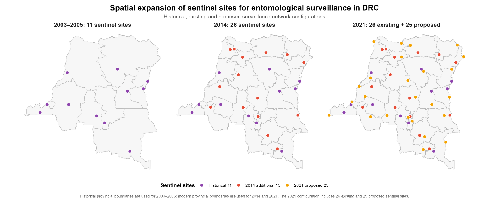
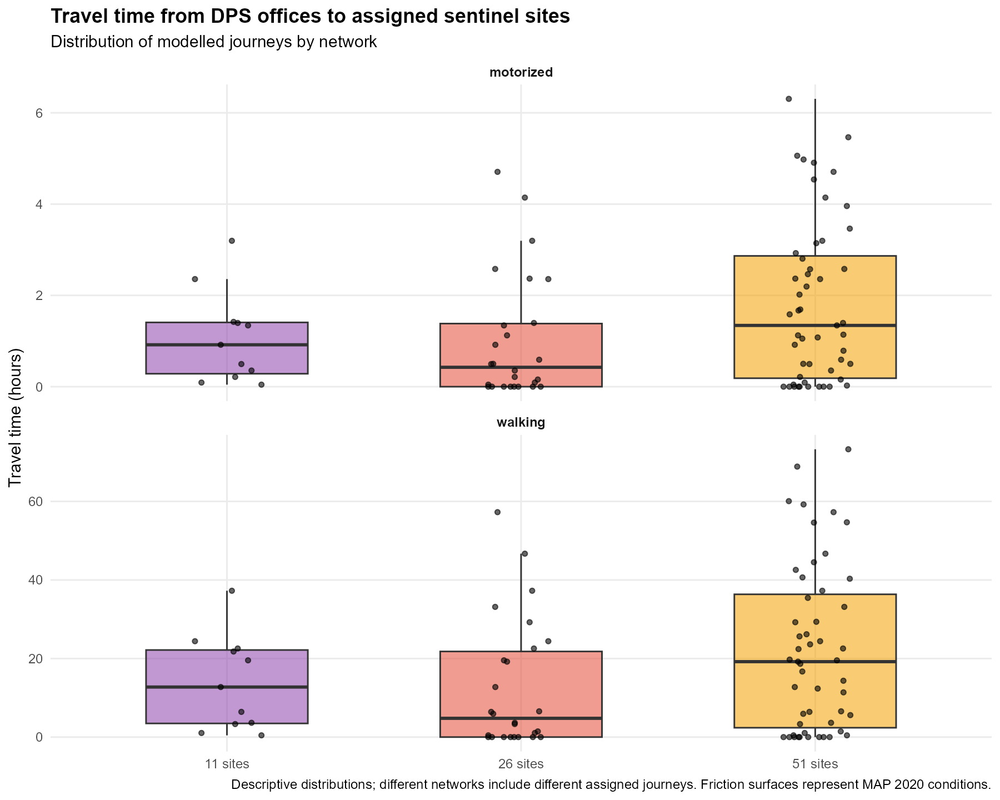
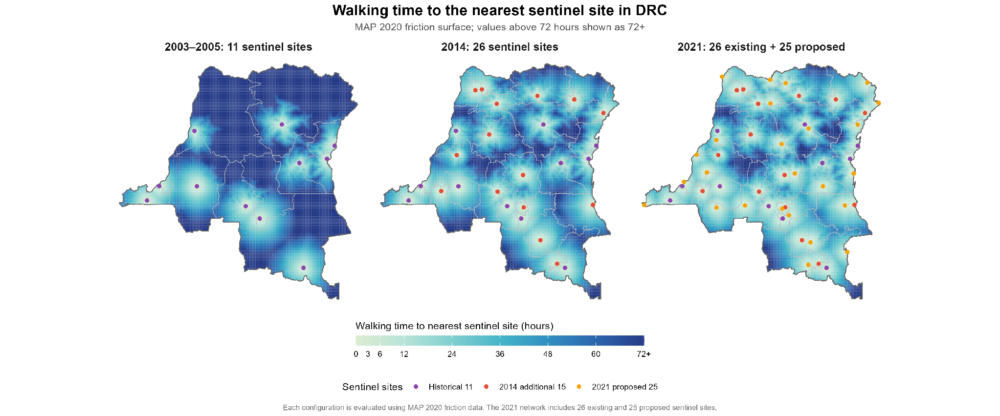
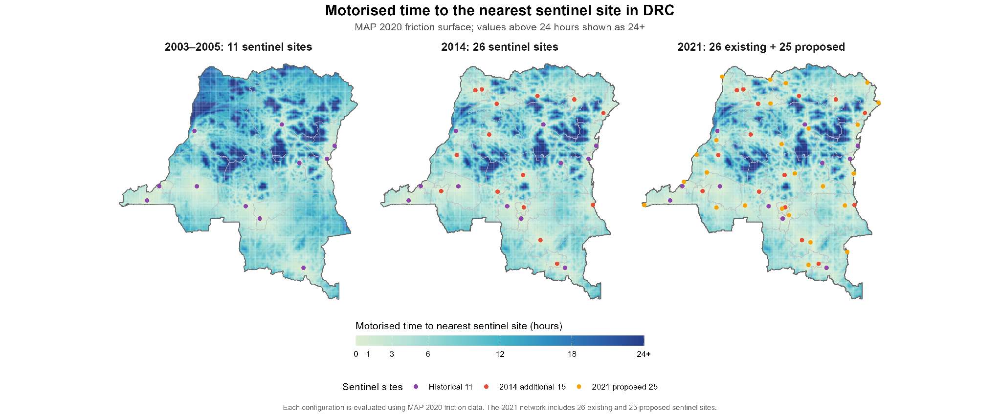

<!--
Render:  quarto render ecr_poster.qmd      (writes ecr_poster.pdf; no R needed)

Layout lives in poster/typst-template.typ. Size, orientation and columns are
set in the `poster:` block above; all type and spacing scale with the paper.

Figures in poster/figures/ were taken from the final presentation and carry
the file names used in output/unified/. To print at full resolution, copy the
pipeline's PNGs over them and re-render.

The poster is one page. If the PDF has two, the content overflowed: shorten
the text or narrow a figure.
-->

# Background

- The DRC accounted for 12.5% of global malaria cases and 11.1% of malaria deaths in 2024. Prevalence ranges from 5.1% in Kinshasa to 61.0% in Bas-Uele.
- Vector populations (*An. gambiae* s.l., *An. funestus* and other *Anopheles* spp.) vary markedly in distribution and insecticide resistance.
- The national malaria programme (PNLP) expanded its entomological sentinel network from 11 sites (2003–05) to 26 (2014), with 52 planned in 2021.
- How these expansions changed geographical coverage and supervisory travel had not been assessed.

# Aim and objectives

**Aim:** to assess the geographical coverage and operational accessibility of the sentinel network under three successive configurations.

1. Map and compare the 11-site, 26-site and proposed 2021 configurations.
2. Estimate walking and motorised travel times between provincial health division (DPS) offices and their assigned sites.
3. Assess national accessibility to the nearest DPS office and sentinel site.
4. Estimate walking-route distances and their implications for surveillance operations.

# Data and methods

- **Networks:** 11 sites (2003–05), 26 sites (2014) and 51 of the 52 planned sites (2021), from PNLP technical reports.
- **Geocoding:** Google Maps, GRID3, Nominatim and Photon. Site confidence: 57 high, 3 medium, 2 low.
- **Travel time:** MAP 2020 walking and motorised friction surfaces; least-cost times and routes on eight-neighbour, geo-corrected transition graphs.
- **Outputs:** DPS-to-assigned-site travel time (88 journeys, 52 distinct pairs), and the share of land area within 24 h walking or 6 h motorised travel of the nearest site.

# The network grew from 11 to 51 mapped sites

The proposed network adds 25 sites. One further planned site, in Kasaï-Central, could not be located.

{#fig-network width=100%}

# New sites are harder to supervise

- 56% of the proposed additional sites are more than 24 walking hours from their assigned DPS office.
- Walking accessibility to the nearest DPS office rose from 9.6% to 23.8% of land area, and does not change under the proposed expansion.

{#fig-assigned width=56%}

# Coverage improved, but large areas remain remote

Under the proposed network, 61.6% of the modelled land area remains beyond 24 hours of walking, and 38.8% beyond six hours of motorised travel, from the nearest sentinel site.

```{=typst}
#key-stats(
  title: [Land area within 24 h walking of the nearest sentinel site],
  ("10.3%", [11 sites]), ("22.9%", [26 sites]), ("38.4%", [51 sites]),
)
```

{#fig-walking width=100%}

```{=typst}
#key-stats(
  title: [Land area within 6 h motorised travel of the nearest sentinel site],
  ("31.2%", [11 sites]), ("52.7%", [26 sites]), ("61.2%", [51 sites]),
)
```

{#fig-motorised width=100%}

# Conclusions

- Network expansion improved geographical coverage.
- The added coverage came with greater operational challenges: many proposed sites need substantially longer travel from DPS offices.
- Accessibility and representativeness are not the same. Accessible sites may not represent the ecological diversity of malaria vectors.
- Site selection should weigh accessibility, ecological representativeness and operational resources together.

# Limitations

Travel times are modelled and were not validated against field journeys. Seasonal flooding, road closures, transport availability and security were not modelled. Some coordinates are administrative centres, not verified facilities. Coverage is a share of land area, not of population or vector ecology. Costs, staffing and sampling frequency were not evaluated.

# Acknowledgements

We thank the DRC Malaria Control Programme; our ECR mentors, Dr. Jailos Lubinda, Dr. James Colborn and Dr. Valérian Turbé; the project reviewers, Dr. Ousmane Diao and Dr. Lembris Njotto; Ms Christine Myalla for technical and methodological support; and the Malaria Atlas Project team (East Africa and Perth) for training.
