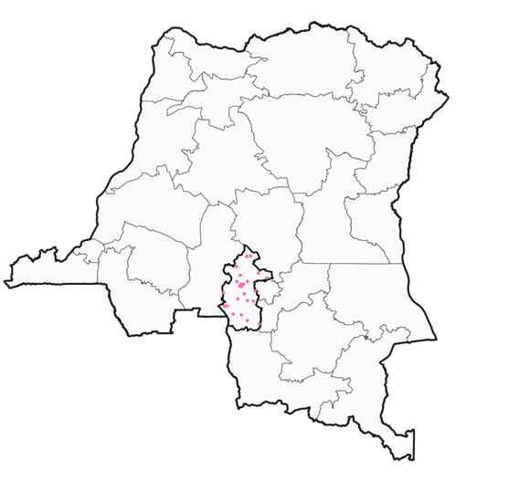
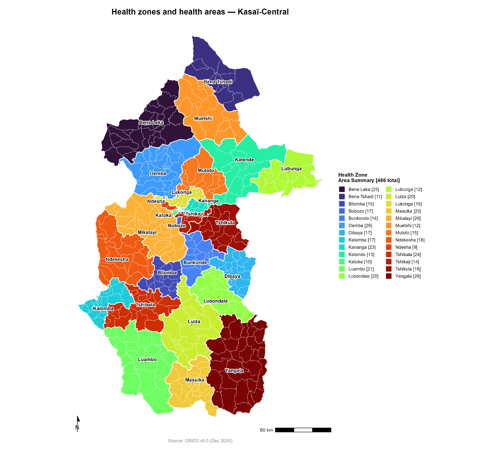
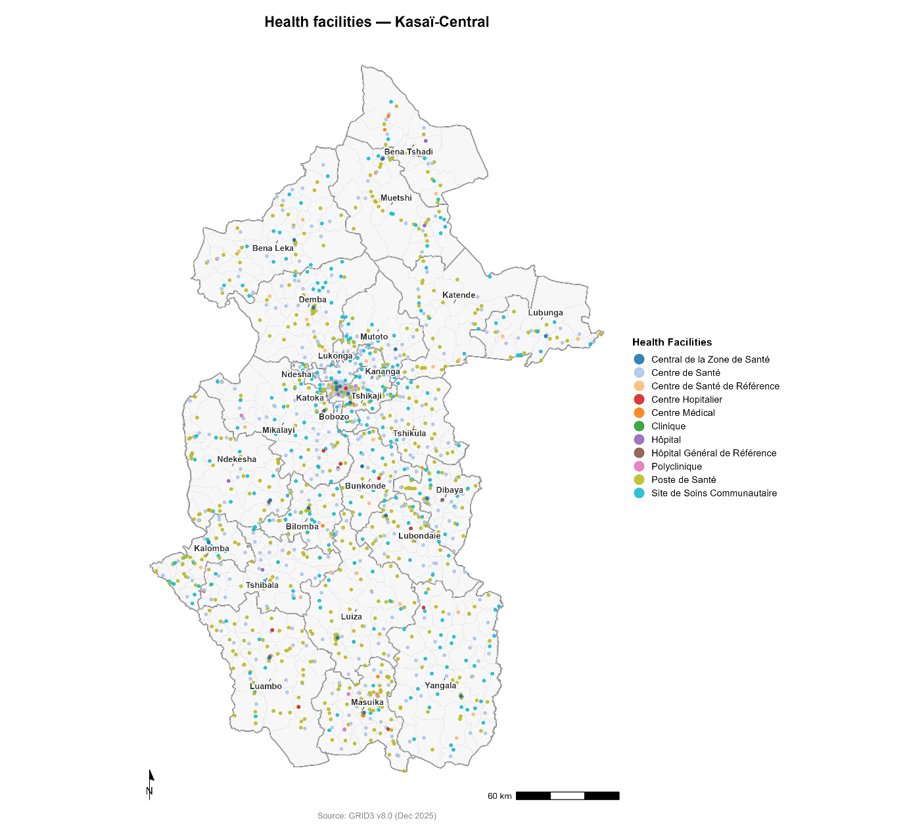
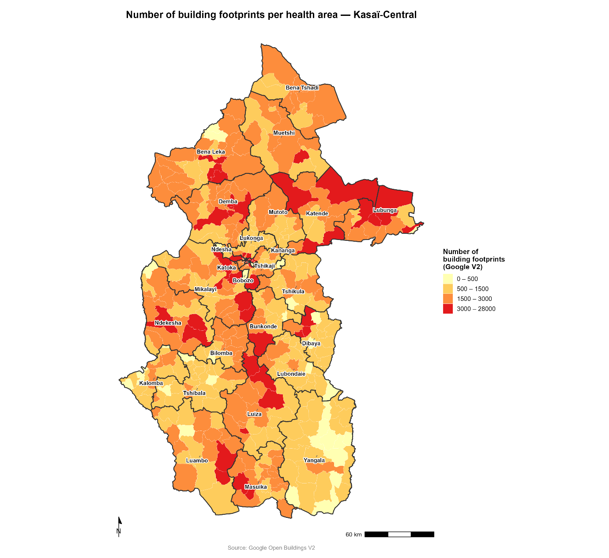
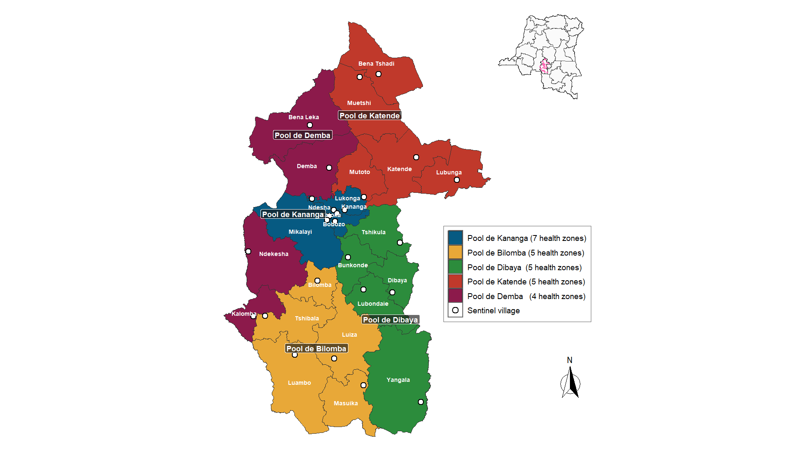

## Background and rationale

Malaria remains a leading cause of morbidity and mortality in the Democratic
Republic of Congo (DRC), and the National Malaria Control Programme (NMCP)
relies on entomological surveillance to track vector species composition,
abundance, and behaviour. Surveillance is organised through **sentinel village
sites** where vectors are sampled longitudinally. Because DRC is vast and its
road network is sparse and often seasonal, the cost of reaching and servicing a
site — and the practicality of training and supervising field teams — is
dominated by **geographic accessibility**, i.e. travel time across the
landscape rather than straight-line distance.

Site selection today is largely driven by convenience and historical precedent
rather than by an explicit trade-off between how *informative* a site is (the
vector dynamics it captures) and how *reachable* it is (the operational cost to
monitor it). This creates two risks: hard-to-reach but epidemiologically
important areas are under-sampled, while easy-to-reach but low-value sites
absorb scarce resources.

DRC's health system is administratively nested — **province → health zone
(*zone de santé*) → health area (*aire de santé*) → village** — which gives a
natural hierarchy for both sampling design and decision-making. Health areas are
each served by a health centre, and the number of areas within a zone scales
roughly with population density.

This project asks whether **quantifying geographic accessibility can improve the
efficiency of malaria vector surveillance** in DRC, using the province of
**Kasaï-Central** as a case study. Victoire collected an entomological
dataset across this province as part of his PhD (26 health zones; sampling in one
health area / village per zone; 25 households per village; 12 months of
collection), which provides per-village species counts to anchor the analysis.

::: {.callout-note}
This proposal is a **new, standalone study** distinct from Victoire's PhD.
It is intended to be developed with ECR mentors and partners toward a peer-reviewed publication, with NMCP as the primary end user.
:::

## Study setting

The study is set in the DRC, one of 26 provinces of which is **Kasaï-Central**,
where Victoire's fieldwork was conducted (@fig-drc).

{#fig-drc width=60%}

Within Kasaï-Central the health system comprises **25 health zones**, roughly
**442–466 health areas**, and about **4,856 villages** (@fig-zones). This nested
structure is the spatial backbone for the accessibility and sampling analyses.

{#fig-zones width=85%}

@tbl-zones summarises the health areas and villages per health zone, based on
the Victoire's compiled data.

| Health zone     | # Health areas | # Villages |
|-----------------|---------------:|-----------:|
| Lubondaie       | 13  | 95   |
| Lubunga         | 12  | 142  |
| Bena Leka       | 25  | 267  |
| Masuika         | 22  | 239  |
| Tshikaji        | 14  | 185  |
| Tshibala        | 24  | 306  |
| Luambo          | 21  | 305  |
| Kalomba         | 16  | 248  |
| Bilomba         | 15  | 224  |
| Bena Tshiadi    | 11  | 120  |
| Bukonde         | 14  | 136  |
| Demba           | 22  | 296  |
| Katende         | 13  | 89   |
| Tshikula        | 17  | 192  |
| Ndesha          | 8   | 110  |
| Muetshi         | 11  | 142  |
| Mutoto          | 15  | 155  |
| Ndekesha        | 18  | 194  |
| Luiza           | 20  | 251  |
| Mikalayi        | 26  | 349  |
| Bobozo          | 9   | 40   |
| Dibaya          | 17  | 169  |
| Katoka          | 10  | 69   |
| Lukonga         | 17  | 127  |
| Kananga         | 23  | 173  |
| Yangala         | 29  | 233  |
| **Total**       | **442** | **4,856** |

: Health areas and villages per health zone, Kasaï-Central. {#tbl-zones}

## Aim and research questions

**Overall aim:** to quantify geographic accessibility across Kasaï-Central and
use it — together with vector density and human-settlement indicators — to
optimise the selection and operation of entomological surveillance sites.

The proposal consolidates several related ideas into one core question with
optional extensions:

**Primary research question**

> Can geographic accessibility improve the efficiency of malaria vector
> surveillance site selection?

**Secondary / extension questions**

1. **Network sizing.** How many surveillance sites are actually needed to
   capture vector dynamics while minimising operational cost and travel time?
2. **Settlement as a predictor.** Do building-footprint metrics improve
   predictions of *Anopheles* occurrence and abundance beyond environmental
   variables alone?
3. **Transmission-opportunity mapping.** Does combining a mosquito-breeding
   layer with a human-exposure layer produce more accurate maps of transmission
   opportunity than either alone?
4. **Training logistics.** How much travel time and operational cost can be
   reduced through accessibility-based planning of program activities such as
   field-team training?

## Objectives

1. Build **provincial travel-time surfaces** to candidate sentinel village sites
   using open geospatial layers (roads, land cover, hydrology, terrain) and
   established accessibility-modelling methods.
2. Cross the accessibility surface with **per-village vector density** to derive
   a **quadrant prioritisation framework** for site selection.
3. Propose a **stratified sampling design** that identifies the most efficient
   locations for longitudinal entomological data collection.
4. (Extension) Evaluate **building footprints** as a predictor of vector
   occurrence/abundance and as a human-exposure layer.
5. (Extension) Develop an **accessibility-based training-logistics tool** that
   tells each zone/area/village the nearest feasible training location.

## Conceptual framework: accessibility × vector density

The analytically richest output cross-references the travel-time surface with
per-village species counts to place every candidate site into one of four
quadrants (@tbl-quadrants). This turns two continuous surfaces into an
actionable decision rule.

| Vector density | Travel time | Interpretation & action |
|----------------|-------------|-------------------------|
| High           | Low         | **Priority** — informative *and* efficient to monitor |
| High           | High        | **High risk, hard to reach** — important but costly; candidate for targeted or rotating effort |
| Low            | Low         | **Easy but low value** — monitor opportunistically |
| Low            | High        | **Deprioritise** — low information per unit cost |

: Quadrant prioritisation of candidate surveillance sites. {#tbl-quadrants}

## Data sources

- **Administrative & population boundaries and health facilities:** GRID3 DRC
  geospatial data (provinces, health zones, health areas, villages, health
  facilities) — see [grid3.org/geospatial-data-drc](https://grid3.org/geospatial-data-drc).
- **Entomological data:** Victoire's province-wide dataset (per-village
  *Anopheles* species counts; 26 health zones; 25 households/village; 12 months).
- **Building footprints / settlement:** Google Open Buildings V2 (@fig-buildings).
- **Environmental & accessibility covariates:** land cover, roads, hydrology,
  topography, rainfall, and vegetation indices from open sources.

@fig-facilities shows the existing health-facility network — the practical
service and access points that anchor travel-time origins and training venues.

{#fig-facilities width=85%}

## Methods

### Accessibility (travel-time) modelling

Construct a friction surface from land cover, road class, slope, and hydrology,
then compute least-cost travel time from population centres and health
facilities to candidate sentinel sites (and vice versa). Produce **preliminary
provincial maps of travel time** to candidate village sites for each health
zone, enabling the NMCP to compare candidate sites on a like-for-like
accessibility basis.

### Vector-density integration and prioritisation

Interpolate/aggregate the per-village species counts to the health-area level
and overlay them on the travel-time surface to populate the quadrant framework
(@tbl-quadrants). Identify and rank monitoring sites where **pre-intervention
vector densities are predicted to be high** and accessibility is favourable.

### Stratified sampling design

Use the combined accessibility and density surfaces to propose a stratified
sampling scheme, and estimate the **minimum number of sites** required to
capture provincial vector dynamics within acceptable precision — directly
addressing the network-sizing question.

### Building footprints and vector distribution (extension)

Because host availability drives biting opportunity, building-footprint density
is a plausible proxy for human population and therefore for where host-seeking
vectors concentrate (@fig-buildings). Test whether building-footprint metrics
improve models of *Anopheles* occurrence/abundance beyond environmental
covariates, and use them to flag health areas within each zone that the NMCP
might prioritise for vector-control tools.

{#fig-buildings width=85%}

### Transmission-opportunity mapping (extension)

Combine a **mosquito-breeding layer** (water, hydrology, topography, rainfall,
vegetation) with a **human-exposure layer** (building footprints, population,
settlement density) to classify areas (@tbl-transmission).

| Breeding | Exposure | Classification |
|----------|----------|----------------|
| High     | High     | **Transmission hotspot** |
| High     | Low      | **Mosquito hotspot** |
| Low      | High     | **Human-concentration area** |

: Transmission-opportunity classification from breeding × exposure layers. {#tbl-transmission}

**Working hypothesis:** building footprints capture vector–host encounter
opportunities while larval-habitat suitability captures mosquito production;
combining both yields more accurate maps of malaria-transmission opportunity
than either approach alone.

### Training-logistics optimisation (extension)

During PhD fieldwork, field teams were grouped into training **pools** by
accessibility rather than by administrative tidiness — e.g. teams reached the
Demba pool more easily from Kalomba and Ndekesha than from Bilomba, because of
distance and road quality (@fig-pools). Formalising this, the travel-time model
can assign each zone/area/village to its **nearest feasible training venue**,
reducing travel time and cost for program activities such as entomological and
epidemiological training.

{#fig-pools width=85%}

## Expected outputs

- Provincial **travel-time surfaces** and per-zone accessibility maps.
- A **quadrant prioritisation** of candidate sentinel sites.
- A **stratified sampling design** with an estimate of the minimum viable number
  of surveillance sites.
- (Extension) Evidence on **building footprints** as a vector-occurrence
  predictor and transmission-opportunity maps.
- (Extension) An **accessibility-based training-logistics** planning tool.
- One or more **peer-reviewed manuscripts** and NMCP-facing decision aids.

## Significance

For the NMCP and funders, the outputs convert scattered field knowledge into
explicit, defensible decisions: where to place sentinel sites, how many are
enough, which health areas to prioritise for vector-control tools, and where to
hold training to minimise cost. The approach is transferable to other DRC
provinces and to comparable resource-limited settings.

## Next steps

Immediate next steps are to (1) confirm scope and lead research question with
mentors, (2) assemble the open geospatial layers and the entomological dataset,
and (3) produce a first provincial travel-time surface for one health zone 
as a proof of concept.

## Key reference

Weiss *et al.* and related accessibility work motivate the core method; the
directly relevant methodological reference is *Quantifying geographic
accessibility to improve efficiency of entomological monitoring*
([bioRxiv 10.1101/779561v2](https://www.biorxiv.org/content/10.1101/779561v2.full)).
